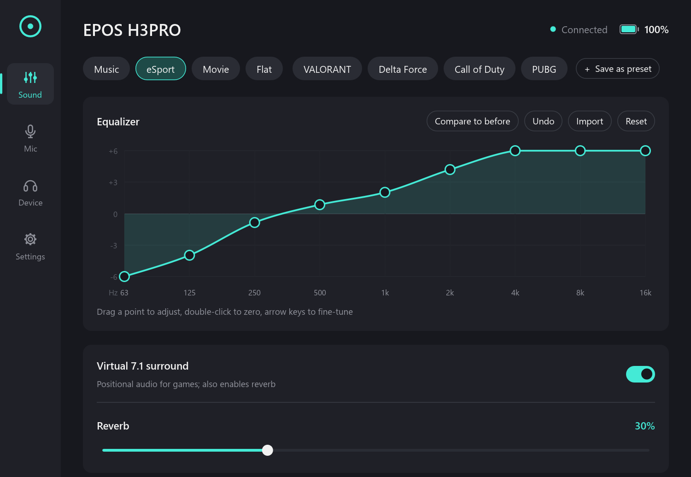
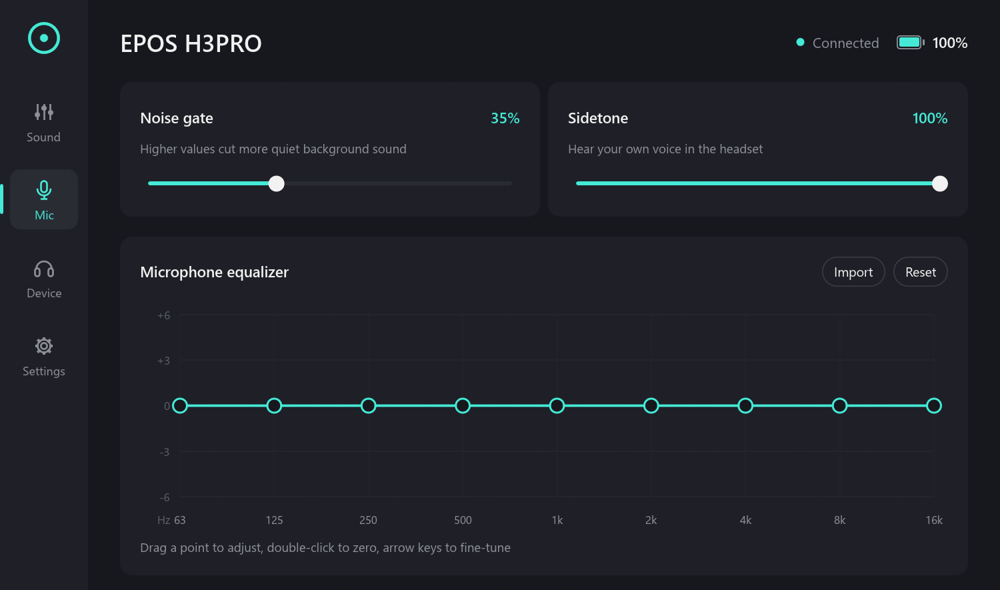
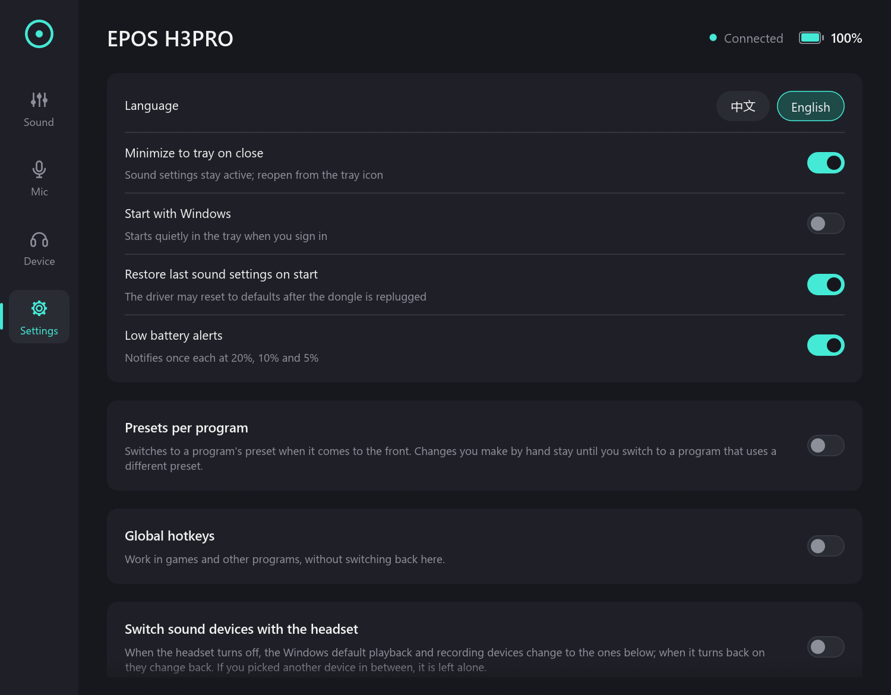

<div align="center">


# eposctl

**The EPOS Gaming Suite is gone. Your headset still works.**

A small, open-source replacement for the discontinued EPOS Gaming Suite on Windows:
EQ, presets, surround, mic, battery and more, in one portable exe.

[](https://github.com/hiyufan/eposctl/releases/latest)
[](https://github.com/hiyufan/eposctl/releases)
[](#get-started)
[](LICENSE)
[](https://github.com/hiyufan/eposctl/stargazers)

**English** | [简体中文](README.zh-CN.md)

<a href="https://github.com/hiyufan/eposctl/releases/latest/download/eposctl-gui.exe"></a>

<sub>Windows 10/11 x64. No installer, no admin rights. Tested with the EPOS H3PRO Hybrid.</sub>

<br>



</div>

> [!NOTE]
> Unofficial community project, not affiliated with or endorsed by EPOS or Demant.
> "EPOS" is a trademark of its owner.

## Why

EPOS left the gaming business, the Gaming Suite was discontinued, and its
servers are offline. Your headset's EQ, surround and mic processing run in the
EPOS audio driver on your PC, and that driver still works. eposctl talks to it
directly, so you keep every setting without the old app or its background service.

- **One exe.** Nothing to install; delete it and it's gone.
- **The same sound.** The factory presets match the official curves exactly.
- **More than the original**: game presets, presets per program, global hotkeys,
  a software ChatMix, AutoEQ import.
- **Open source** (MIT), written in Rust.

## Features

| | |
|---|---|
| **Sound** | 9-band EQ you drag with the mouse, factory presets (music, esport, movie, flat), virtual 7.1 surround, reverb, undo/redo, compare to before |
| **Game presets** | Footstep presets for **VALORANT**, **Delta Force**, **Call of Duty** and **PUBG**, tuned for the H3 series ([how they were made](docs/game-presets.md)) |
| **Microphone** | Noise gate, sidetone, 9-band mic EQ |
| **Your presets** | Save, overwrite, import and export as JSON; load an [AutoEQ](https://github.com/jaakkopasanen/AutoEq) or Equalizer APO file |
| **Automation** | Switch preset when a game comes to the front, global hotkeys, move the Windows default sound devices when the headset turns off and back on |
| **ChatMix** | Game / voice balance through the Windows volume mixer (Discord, KOOK, TeamSpeak, QQ, WeChat and more count as voice) |
| **Device** | Battery with a runtime estimate, low-battery alerts, firmware, ANC state |
| **Tray** | Battery ring icon, preset menu, surround toggle, start with Windows |
| **Language** | English and 简体中文 |

<table>
  <tr>
    <td></td>
    <td></td>
  </tr>
</table>

## Get started

1. **Have the EPOS audio driver** (`EPOS APO`). The Gaming Suite installer puts
   it on your system, so if you ever installed the Gaming Suite you have it.
   The Gaming Suite app itself can stay closed or be uninstalled.
2. **Download** [`eposctl-gui.exe`](https://github.com/hiyufan/eposctl/releases/latest/download/eposctl-gui.exe)
   and put it anywhere.
3. **Run it**, with the dongle plugged in and the headset on.

> [!TIP]
> Windows may say "Windows protected your PC" because the exe is not code-signed.
> Click **More info**, then **Run anyway**. Every release is built from this
> source by [GitHub Actions](https://github.com/hiyufan/eposctl/actions/workflows/release.yml)
> and lists the SHA-256 of each file.

## Supported headsets

| Headset | Status |
|---|---|
| EPOS H3PRO Hybrid (USB dongle `1395:0303`) | Tested, all features work |
| Other EPOS gaming headsets | Untested. [Send a device report](https://github.com/hiyufan/eposctl/issues/new?template=device-report.yml) |

Have another model? Run `eposctl report --query` and attach the output to a
[device report](https://github.com/hiyufan/eposctl/issues/new?template=device-report.yml).
It only reads from the headset and leaves out the serial number. Reports are
how new models get supported.

## FAQ

<details>
<summary><b>Do I need the EPOS Gaming Suite?</b></summary>

Only its driver. The sound settings are applied by the EPOS audio driver
(`EAPO.dll`), which the Gaming Suite installer puts on your system. The app and
its service are not needed.
</details>

<details>
<summary><b>Does it change my headset's firmware?</b></summary>

No. EQ, surround, reverb and the noise gate are processed by the driver on your
PC. The only setting eposctl sends to the headset is the sidetone level, as the
official app did.
</details>

<details>
<summary><b>My settings reset after I replugged the dongle.</b></summary>

The driver can fall back to its defaults. Keep "Restore last sound settings on
start" on and let eposctl start with Windows; it puts your settings back.
</details>

<details>
<summary><b>Where are my settings stored?</b></summary>

In `%APPDATA%\eposctl\config.json`. "Start with Windows" adds
`eposctl-gui.exe --minimized` to `HKCU\Software\Microsoft\Windows\CurrentVersion\Run`.
</details>

## Using it

<details>
<summary><b>Tips for the app</b></summary>

- **EQ**: drag a point, click in a column to move that band there, double-click
  to reset it to 0 dB. Click the curve, then ←/→ picks a band and ↑/↓ changes it
  by 0.5 dB (Shift: 1 dB). Ctrl+Z / Ctrl+Y undo and redo.
- **Compare to before** switches between the current sound and the sound when
  you last picked a preset.
- **Your presets**: right-click one to overwrite or delete it.
- **Presets per program**: add a rule for a program (pick it from the recently
  used list or type `game.exe`) and the preset changes when it comes to the front.
  Other programs get the "other programs" preset, or nothing changes. Changes
  you make by hand stay until you switch to a program with a different preset.
- **Global hotkeys** (off by default): next preset, previous preset, surround
  on/off. Defaults are Ctrl+Alt+PageDown, Ctrl+Alt+PageUp and Ctrl+Alt+Home;
  click one to record another.
- **Switch sound devices with the headset**: the dongle stays plugged in when
  the headset is off, so Windows keeps sending sound to it. With this on,
  turning the headset off moves the default playback and recording devices to
  the ones you pick, and turning it on moves them back.
- **Game / voice balance**: left makes the game louder, right makes voice chat
  louder. Volumes you set by hand stay in proportion, and turning it off puts
  them back. Two hotkeys can nudge it.
- **EQ files**: "Import" next to either EQ loads `ParametricEQ.txt`,
  `GraphicEQ.txt` or an AutoEQ CSV. The curve is read at the nine band centres
  (62.5 Hz to 16 kHz, one octave apart) and shifted to fit ±6 dB; the preamp is
  ignored.
- The tray icon's ring shows the battery level. Left-click opens the window.
  Launching the exe again brings the running one to the front.
</details>

<details>
<summary><b>Command line (<code>eposctl.exe</code>)</b></summary>

```text
eposctl list                     # devices exposing an EPOS APO channel
eposctl status [--raw]           # current DSP settings
eposctl preset music             # flat | music | esport | movie
eposctl preset valorant          # valorant | delta-force | cod | pubg
eposctl eq 6 4 1 0 -1 0 1 4 6    # 9 speaker bands in dB (-6..6), low to high
eposctl mic-eq 0 0 0 0 0 0 0 0 0
eposctl eq-import ParametricEQ.txt [--mic] [--dry-run]
eposctl surround on
eposctl reverb 30                # percent
eposctl gate 40                  # percent
eposctl --device 1395:0303 status

eposctl info                     # name, serial, firmware, battery, sidetone (HID)
eposctl sidetone [0-255]         # show or set sidetone level
eposctl monitor [--raw]          # print headset events (read-only)
eposctl report [--query]         # read-only device report for a GitHub issue

eposctl audio                    # Windows playback/recording devices, * = default
eposctl audio default speaker    # make a device the default (part of its name)
eposctl audio default mic --input
eposctl audio sessions           # programs playing on the default device, with volume
```

`eposctl.exe` is attached to every release. From Git Bash, write paths with
forward slashes (`D:/tools/eposctl.exe`).

Sidetone: on the H3PRO used for testing, sidetone was inaudible at every level,
from both the official app and eposctl, although the headset accepts and reports
the value. Reports from other units are welcome.
</details>

## How it works

The EPOS APO (`EAPO.dll`, loaded by `audiodg.exe`) reads its settings from a
named shared-memory block that the official service used to write. eposctl
writes the same block directly. Battery, firmware and sidetone go over HID to
the dongle. [docs/protocol.md](docs/protocol.md) has the layout and the
evidence for each field, and [ROADMAP.md](ROADMAP.md) has what comes next.

Prior art: [eposwitch](https://github.com/Ad-Bean/eposwitch) talks to the
official service over its named pipes. Its notes were a useful reference.

## Building

```sh
cargo build --release
```

With only MinGW (no MSVC build tools), use the GNU toolchain:
`rustup override set stable-x86_64-pc-windows-gnu`.

## Contributing

Bug reports, device reports and pull requests are welcome. If eposctl brought
your headset back to life, **a ⭐ helps other EPOS owners find it.**

## License

[MIT](LICENSE)
