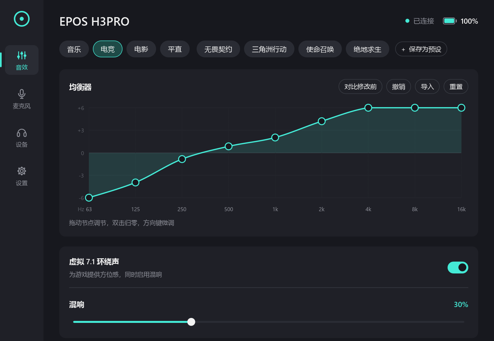
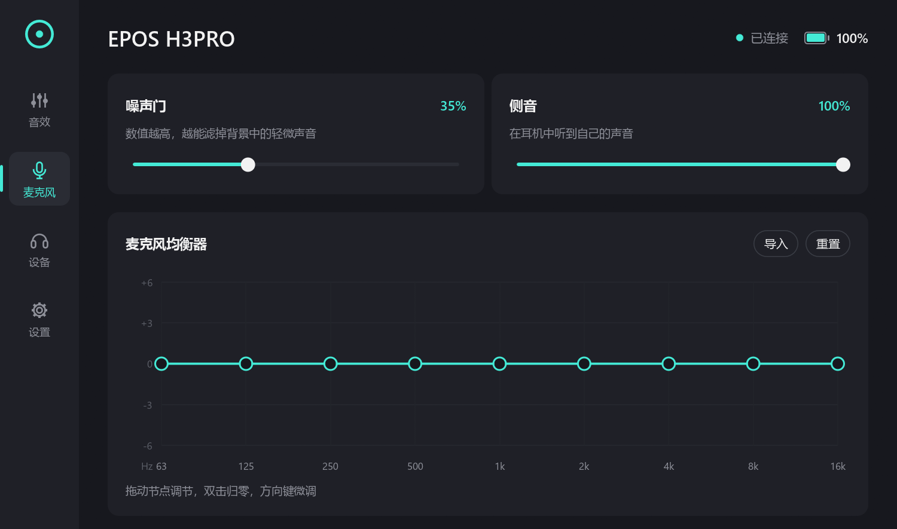
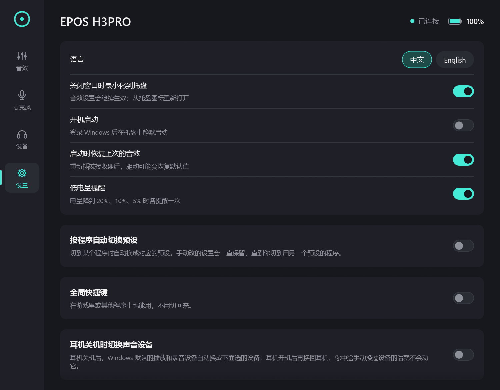

<div align="center">


# eposctl

**EPOS Gaming Suite 停服了，你的耳机还能接着用。**

开源、免安装的 EPOS Gaming Suite 替代品（Windows）：均衡器、预设、7.1 环绕声、
麦克风、电量……一个 exe 全搞定。

[](https://github.com/hiyufan/eposctl/releases/latest)
[](https://github.com/hiyufan/eposctl/releases)
[](#快速开始)
[](LICENSE)
[](https://github.com/hiyufan/eposctl/stargazers)

[English](README.md) | **简体中文**

<a href="https://github.com/hiyufan/eposctl/releases/latest/download/eposctl-gui.exe"></a>

<sub>Windows 10/11 64 位，免安装，不需要管理员权限。已在 EPOS H3PRO Hybrid 上测试。</sub>

<br>



</div>

> [!NOTE]
> 这是社区做的非官方项目，与 EPOS / Demant 没有任何关系，也未获其认可。
> “EPOS”是其所有者的商标。

## 为什么做这个

EPOS（原森海塞尔游戏耳机）已经退出游戏耳机业务，Gaming Suite 停止维护，服务器也已下线。
但耳机的均衡器、环绕声、麦克风处理其实都是电脑上的 EPOS 音效驱动在做，这个驱动现在还能用。
eposctl 直接和驱动通信，不用官方软件、也不用它的后台服务，原来的设置全都能调。

- **一个 exe**：不用安装，不想用了直接删掉。
- **音色不变**：出厂预设和官方曲线完全一致。
- **比原版多**：游戏预设、按程序自动切预设、全局快捷键、软件 ChatMix、AutoEQ 导入。
- **开源**：MIT 许可，用 Rust 编写。

## 功能

| | |
|---|---|
| **音效** | 鼠标拖动的九段均衡器，出厂预设（音乐、电竞、电影、平直），虚拟 7.1 环绕声，混响，撤销/重做，与修改前对比 |
| **游戏预设** | 为听脚步声调的 **无畏契约**、**三角洲行动**、**使命召唤**、**绝地求生** 预设，针对 H3 系列调整（[怎么调出来的](docs/game-presets.md)） |
| **麦克风** | 噪声门、侧音、九段麦克风均衡器 |
| **我的预设** | 保存、覆盖，导入导出 JSON；可以直接载入 [AutoEQ](https://github.com/jaakkopasanen/AutoEq) / Equalizer APO 的 EQ 文件 |
| **自动化** | 切到某个游戏时自动换预设；全局快捷键；耳机关机时自动切换 Windows 默认声音设备，开机再切回来 |
| **ChatMix** | 游戏 / 语音平衡，通过 Windows 音量合成器调节（Discord、KOOK、YY、QQ、微信、TeamSpeak 等算作语音） |
| **设备** | 电量与剩余时间估算、低电量提醒、固件版本、主动降噪状态 |
| **托盘** | 电量环图标、预设菜单、一键开关环绕声、开机启动 |
| **语言** | 简体中文、English |

<table>
  <tr>
    <td></td>
    <td></td>
  </tr>
</table>

## 快速开始

1. **确认装了 EPOS 音效驱动**（`EPOS APO`）。它是 Gaming Suite 安装包一起装上的，
   以前装过 Gaming Suite 就有。Gaming Suite 软件本身可以不开，也可以卸载。
2. **下载** [`eposctl-gui.exe`](https://github.com/hiyufan/eposctl/releases/latest/download/eposctl-gui.exe)，放在哪里都行。
3. **双击运行**，插好接收器，打开耳机。

> [!TIP]
> 因为 exe 没有代码签名，Windows 可能会提示“Windows 已保护你的电脑”。
> 点 **更多信息**，再点 **仍要运行** 即可。每个版本都由
> [GitHub Actions](https://github.com/hiyufan/eposctl/actions/workflows/release.yml)
> 从本仓库源码自动构建，发布页附有每个文件的 SHA-256。

## 支持的耳机

| 耳机 | 状态 |
|---|---|
| EPOS H3PRO Hybrid（USB 接收器 `1395:0303`） | 已测试，全部功能可用 |
| 其他 EPOS 游戏耳机 | 未测试，欢迎[提交设备报告](https://github.com/hiyufan/eposctl/issues/new?template=device-report.yml) |

手上有别的型号？运行 `eposctl report --query`，把输出贴到
[设备报告](https://github.com/hiyufan/eposctl/issues/new?template=device-report.yml)里。
这个命令只读取耳机信息，不包含序列号。有了报告才能适配新型号。

## 常见问题

<details>
<summary><b>需要装 EPOS Gaming Suite 吗？</b></summary>

只需要它的驱动。音效是 EPOS 音效驱动（`EAPO.dll`）处理的，驱动由 Gaming Suite
安装包装到系统里。Gaming Suite 软件和它的后台服务都不需要。
</details>

<details>
<summary><b>会改耳机固件吗？</b></summary>

不会。均衡器、环绕声、混响、噪声门都是电脑上的驱动在处理。eposctl 唯一发给耳机的设置是侧音音量，
和官方软件的做法一样。
</details>

<details>
<summary><b>重新插拔接收器后设置变回去了？</b></summary>

驱动有时会恢复默认值。打开“启动时恢复上次的音效”并设置开机启动，eposctl 会自动把设置恢复回来。
</details>

<details>
<summary><b>设置保存在哪里？</b></summary>

`%APPDATA%\eposctl\config.json`。“开机启动”会在
`HKCU\Software\Microsoft\Windows\CurrentVersion\Run` 里添加 `eposctl-gui.exe --minimized`。
</details>

## 使用说明

<details>
<summary><b>界面小技巧</b></summary>

- **均衡器**：拖动节点调节；在某一列里单击，把这个频段直接移到点击的位置；双击归零。
  点一下曲线后，←/→ 选频段，↑/↓ 每次调 0.5 dB（按住 Shift 为 1 dB）。Ctrl+Z / Ctrl+Y 撤销和重做。
- **对比修改前**：在当前音效和上次选预设时的音效之间切换，方便 A/B 对比。
- **我的预设**：右键可以覆盖或删除。
- **按程序自动切换预设**：给某个程序加一条规则（从最近用过的程序里选，或者直接输入 `game.exe`），
  它切到前台时就换成对应预设。其他程序用“其他程序”预设，或者保持不变。
  手动改的设置会一直保留，直到你切到另一个设了预设的程序。
- **全局快捷键**（默认关闭）：下一个预设、上一个预设、开关环绕声。默认是 Ctrl+Alt+PageDown、
  Ctrl+Alt+PageUp、Ctrl+Alt+Home，点一下可以录制新的组合键。
- **耳机关机时切换声音设备**：耳机关了接收器还插着，Windows 会继续往它输出声音。
  打开这个功能后，耳机一关机，默认播放和录音设备就会换成你选的设备（比如音箱和笔记本自带麦克风），
  耳机开机再换回来。
- **游戏 / 语音平衡**：往左游戏声音更大，往右语音更大。你手动设的音量会按比例保留，关掉后恢复原样。
  有两个快捷键可以微调。
- **导入 EQ 文件**：两个均衡器旁边的“导入”可以载入 `ParametricEQ.txt`、`GraphicEQ.txt`
  或 AutoEQ 的 CSV。曲线在九个频段中心（62.5 Hz 到 16 kHz，每段相差一个八度）取值，
  并整体平移到 ±6 dB 以内，忽略前级增益（preamp）。
- 托盘图标的圆环显示电量，左键单击打开窗口。再次运行 exe 会把已经在运行的窗口调到前面。
</details>

<details>
<summary><b>命令行（<code>eposctl.exe</code>）</b></summary>

```text
eposctl list                     # 列出带 EPOS APO 的设备
eposctl status [--raw]           # 当前音效设置
eposctl preset music             # flat | music | esport | movie
eposctl preset valorant          # valorant | delta-force | cod | pubg
eposctl eq 6 4 1 0 -1 0 1 4 6    # 九个频段（dB，-6..6），从低到高
eposctl mic-eq 0 0 0 0 0 0 0 0 0
eposctl eq-import ParametricEQ.txt [--mic] [--dry-run]
eposctl surround on
eposctl reverb 30                # 百分比
eposctl gate 40                  # 百分比
eposctl --device 1395:0303 status

eposctl info                     # 型号、序列号、固件、电量、侧音（HID）
eposctl sidetone [0-255]         # 查看或设置侧音
eposctl monitor [--raw]          # 打印耳机事件（只读）
eposctl report [--query]         # 生成只读的设备报告，用于提 issue
eposctl raw --probe              # 只读的 HID 查询，用于研究协议

eposctl audio                    # Windows 播放/录音设备，* 为默认
eposctl audio default speaker    # 设为默认设备（名称的一部分即可）
eposctl audio default mic --input
eposctl audio sessions           # 默认设备上正在播放的程序及音量
```

每个版本都附带 `eposctl.exe`。在 Git Bash 里路径要用正斜杠（`D:/tools/eposctl.exe`）。

关于侧音：测试用的 H3PRO 上，无论用官方软件还是 eposctl，任何档位都听不到侧音，
但耳机能接收并返回这个值。欢迎其他用户反馈。
</details>

## 原理

EPOS APO（`EAPO.dll`，由 `audiodg.exe` 加载）从一块命名共享内存里读取设置，
以前由官方服务写入，现在由 eposctl 直接写。电量、固件、侧音通过 HID 和接收器通信。
数据布局和每个字段的依据见 [docs/protocol.md](docs/protocol.md)，后续计划见 [ROADMAP.md](ROADMAP.md)。

参考：[eposwitch](https://github.com/Ad-Bean/eposwitch) 通过命名管道与官方服务通信，
它的笔记帮了不少忙。

## 自己编译

```sh
cargo build --release
```

只有 MinGW、没有 MSVC 编译工具时，换成 GNU 工具链：
`rustup override set stable-x86_64-pc-windows-gnu`。

## 参与

欢迎提 bug、设备报告和 PR。如果 eposctl 让你的耳机“复活”了，
**点个 ⭐ 能让更多 EPOS 用户找到它。**

## 许可证

[MIT](LICENSE)
